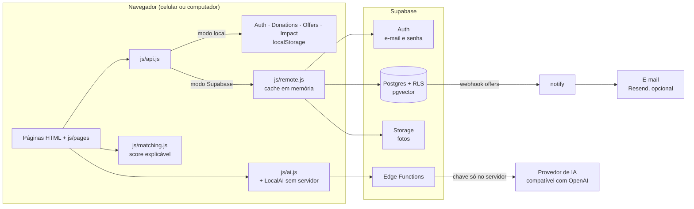

# Arquitetura do LALA Bridge

## Visão geral

## Dois backends, a mesma tela

As páginas falam só com `Api` (`js/api.js`), que é assíncrona e devolve sempre `{ success, message, ... }`.

|        | Modo local                                        | Modo Supabase                                                 |
| ------ | ------------------------------------------------- | ------------------------------------------------------------- |
| Quando | Sem `SUPABASE_URL` / `SUPABASE_ANON_KEY`          | Com as duas variáveis                                         |
| Dados  | `localStorage` do navegador                       | Postgres, lido pelo `Remote.pull()` e guardado só em memória  |
| Regras | JS (`Offers`, `Auth`...)                          | Funções SQL e RLS (as mesmas regras, testadas nos dois lados) |
| Login  | Hash PBKDF2 no navegador (paliativo)              | Supabase Auth                                                 |
| IA     | Alternativas locais (regras, ditado do navegador) | Edge Functions + provedor de IA                               |
| Uso    | Demonstração offline, desenvolvimento, testes     | Piloto com pessoas reais                                      |

As leituras (`Donations.getAll()`, `Offers.getForUser()`...) são síncronas e leem o `Store` (`js/store.js`), que no modo Supabase é preenchido pelo servidor respeitando o RLS. Assim, as telas não sabem de onde vêm os dados.

## Banco (supabase/migrations)

- **profiles** (1:1 com `auth.users`, criado por gatilho no cadastro), **verification_codes**, **donations**, **needs**, **offers**, **impact_updates**, **flags** e **ai_usage**.
- **RLS em todas as tabelas** e privilégios por coluna: ninguém altera o próprio papel nem o status de doações, pedidos e ofertas direto pelo app.
- **Funções** `offer_help`, `request_donation`, `respond_offer`, `mark_delivered`, `cancel_offer`, `get_offer_contact`, `add_impact_update`, `impact_stats`, `export_my_data`, `delete_my_account`, `semantic_scores`.
- **Gatilhos de confiança** criam sinalizações para revisão humana.
- Testes: `npm run test:db`.

## Fluxo principal

1. O Lalíder descreve a necessidade (texto ou voz). A IA estrutura o pedido e ele revisa antes de publicar.
2. O doador publica a doação com fotos. A IA sugere categoria, estado e specs, e o doador confirma.
3. O matching ordena as sugestões e explica o motivo ("Atende 8 GB de RAM; Mesmo estado (PE); Pedido urgente").
4. Uma parte oferece ou pede; a outra aceita ou recusa. Só então os contatos aparecem.
5. Alguém marca a entrega. O Lalíder conta como ajudou, e o doador recebe o resumo.
6. `/impacto` mostra os números agregados.

## Código no front-end

| Arquivo                                                                          | Responsabilidade                                                 |
| -------------------------------------------------------------------------------- | ---------------------------------------------------------------- |
| `js/config.js`, `js/env.js`                                                      | Configuração e variáveis públicas (geradas por `scripts/env.js`) |
| `js/i18n.js`, `locales/`                                                         | PT-BR (padrão), inglês e espanhol                                |
| `js/store.js`                                                                    | Armazenamento local ou em memória                                |
| `js/auth.js`, `js/donations.js`, `js/offers.js`, `js/impact.js`, `js/privacy.js` | Regras no modo local                                             |
| `js/remote.js`                                                                   | Backend Supabase                                                 |
| `js/api.js`                                                                      | Interface única para as páginas                                  |
| `js/matching.js`                                                                 | Score explicável e recomendações                                 |
| `js/ai.js`                                                                       | Chamadas de IA e alternativas locais                             |
| `js/trust.js`                                                                    | Sinalizações para revisão humana                                 |
| `js/app.js`                                                                      | Interface comum: navbar, modal, cards, acessibilidade            |
| `js/pages/*.js`                                                                  | Uma página por arquivo                                           |

Os scripts são clássicos (sem bundler) para o projeto continuar simples de rodar e de contribuir: `npm install && npm run dev`.
